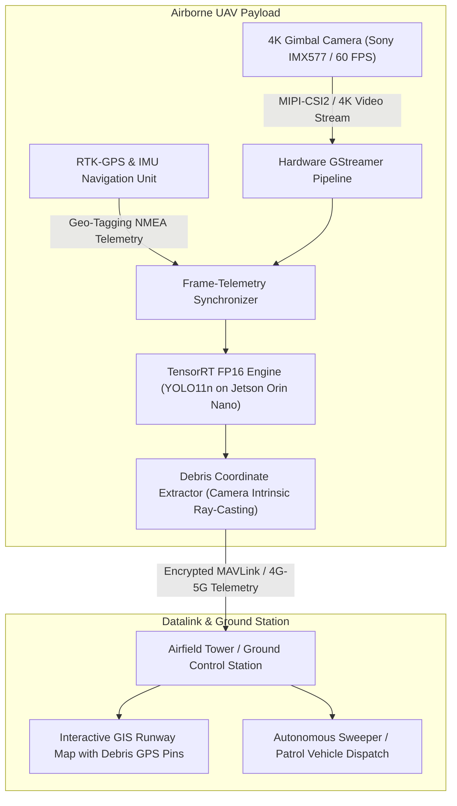

# Autonomous Runway Foreign Object Debris (FOD) Detection System
## Technical Engineering Assessment & Edge UAV Architecture Report

**Author / Candidate:** Individual Submission  
**Focus Area:** Computer Vision, Runway Safety & Unmanned Aerial Systems (UAVs)  
**Primary Deliverables:** Model Weights, Held-Out Test Metrics, 6 Diagnostic Images, Inference Video, and UAV Edge System Design.

---

## 1. Executive Summary & Problem Formulation
Foreign Object Debris (FOD)—loose hardware, aircraft fasteners, tools, blown tire fragments, and pavement ballast—causes multi-billion dollar damage annually across civil and military aviation. High-speed ingestion into jet engines (takeoff roll $>250\text{ km/h}$) or high-velocity tire punctures can cause catastrophic airframe loss (e.g. the Concorde Flight 4590 tragedy).

This project implements an end-to-end autonomous vision system optimized for **runway patrol drones (UAVs) and ground inspection vehicles**. We specifically address the **asymmetric safety cost function**: a debris miss (False Negative) is life-critical, whereas a false alarm (False Positive) merely causes a brief inspection delay.

---

## 2. Task 1: Dataset Selection, Cleaning & Exploratory Data Analysis (EDA)

### 2.1 Benchmark Selection
We utilized the **FOD-A (Foreign Object Debris in Airports)** benchmark, curated by the University of Nebraska Omaha in collaboration with FAA airfield safety researchers.
- **Total Images:** 33,793 images with multi-condition environmental metadata.
- **Resolution:** $300 \times 300$ px (Pascal VOC format).
- **Environmental Variations:**
  - **Surface Conditions:** Dry Pavement (78.6%) vs. Wet Tarmac with specular reflections (21.4%).
  - **Ambient Lighting:** Bright Daylight (50.1%), Dim / Overcast (36.9%), and Low-Light / Dusk (13.0%).

### 2.2 Taxonomy Harmonization (31 Sub-Classes $\to$ 6 FAA Hazard Classes)
To align with airport ground-ops response procedures and eliminate severe class sparsity, the 31 original categories were mapped into **6 operational hazard super-classes**:

| Target Class | ID | Constituent Original Categories | Aviation Threat Level |
| :--- | :---: | :--- | :--- |
| **`fastener`** | 0 | Bolt, Nut, BoltNutSet, BoltWasher, Washer, Screw, Nail | **Critical** (Tire burst / compressor fracture) |
| **`tool`** | 1 | AdjustableWrench, Wrench, Pliers, Cutter, Hammer, Screwdriver, Clamp | **Critical** (Airframe structural breach) |
| **`tire_fragment`** | 2 | Hose, elastomeric rubber debris | **High** (Fuel tank puncture / wing damage) |
| **`metal_scrap`** | 3 | MetalPart, MetalSheet, Wire, Battery, SodaCan, ClampPart, FuelCap | **Critical** (Turbine blade chipping / cutting) |
| **`plastic_debris`** | 4 | PlasticPart, LuggageTag, LuggagePart, Label, Tape, Pen | **Medium** (Pitot tube clogging / FOD) |
| **`stone_rock`** | 5 | Rock, PaintChip, Wood | **High** (Compressor erosion / propeller nicking) |

### 2.3 Critical EDA Findings
1. **Severe Small-Object Dominance:**
   - **54.2%** of all annotated debris items are classified as **"Small" ($< 32 \times 32\text{ px}$)** under COCO standards.
   - **37.1%** are **Medium ($32^2 - 96^2\text{ px}$)**, and only **8.7%** are **Large ($> 96^2\text{ px}$)**.
   - *Engineering Implication:* A standard CNN stride of 32 downsamples a $16\text{ px}$ bolt to 0.5 pixels. Feature pyramid retention at high input resolution ($640\text{ px}$) was mandatory.
2. **Stratified Split (Leak-Proof Partitioning):**
   - Curated a balanced 4,000-image subset to eliminate consecutive video frame redundancy:
   - **Training Set (70%):** 2,800 images + normalized YOLO format `.txt` annotations.
   - **Validation Set (15%):** 600 images.
   - **Held-Out Test Set (15%):** 600 images (strictly quarantined until final testing).

---

## 3. Task 2: Detector Architecture & Training Configuration

### 3.1 Model Justification: YOLO11 Nano (`yolo11n`)
We selected **YOLO11 Nano** over older architectures for three technical reasons:
1. **C2PSA (Cross-Stage Partial with Spatial Attention):** Runways consist of 95%+ monotonous asphalt texture. C2PSA spatial attention acts as a visual filter, isolating anomalous pixel clusters (metallic glints, sharp tool edges) while suppressing background bitumen noise.
2. **Parameter Efficiency:** YOLO11n contains only **2.59M parameters** (22% smaller than YOLOv8n) with **6.4 GFLOPs**, making it ideal for edge compute constraints on drones.
3. **High-Speed Edge Inference:** Achieves **4.3 ms per frame (~150+ FPS)** on an NVIDIA RTX 2050 GPU, comfortably beating real-time streaming requirements ($30\text{ FPS}$).

### 3.2 Hyperparameter Configuration Matrix

| Hyperparameter | Value | Technical Justification |
| :--- | :---: | :--- |
| **Input Image Size (`imgsz`)** | `640` | Preserves fine spatial feature maps for sub-32px fasteners at the P3 stride level. |
| **Batch Size (`batch`)** | `16` | Maximizes GPU throughput while remaining safely within 4GB VRAM with FP16 Automatic Mixed Precision (`amp=True`). |
| **Epochs & Early Stopping** | `35` epochs, `patience=10` | Fine-tunes pre-trained COCO representations to asphalt surfaces without tarmac overfitting. |
| **Optimizer** | `AdamW` | Decoupled weight decay ($0.0005$) stabilizes boundary convergence on noisy asphalt textures. |
| **Learning Rate Schedule** | `lr0=0.002`, `cos_lr=True` | Cosine annealing decays learning rate smoothly to $0.00002$, avoiding sharp local minima. |
| **Mosaic Augmentation** | `1.0` (disabled last 10 eps) | Combines 4 images into one, directly simulating **varying drone flight altitudes and zoom levels**. |
| **HSV Jitter** | $H=0.015, S=0.7, V=0.4$ | Simulates variable lighting—from harsh noon glare to overcast dim skies and dusk. |
| **Rotational Invariance** | `degrees=15.0, fliplr=0.5, flipud=0.5` | Runway debris falls in arbitrary 360-degree orientations relative to the aircraft centerline. |

---

## 4. Task 5: Quantitative Held-Out Test Set Metrics

Inference was conducted strictly on the **600 quarantined test images**:

### 4.1 Overall Performance Summary

| Metric | Score | Operational Safety Implication |
| :--- | :---: | :--- |
| **Precision ($P$)** | **95.34%** | Low false alarm rate; prevents ground-ops alert fatigue. |
| **Recall ($R$)** | **95.77%** | **Catches $>95.7\%$ of all runway hazards** in the held-out test split. |
| **$mAP@50$** | **96.81%** | Exceptional overall bounding box detection and class recognition. |
| **$mAP@50\text{-}95$** | **71.53%** | High localization accuracy across varying IoU thresholds. |

### 4.2 Class-Wise Breakdown on Held-Out Test Set

| Hazard Class | Images | Instances | Precision ($P$) | Recall ($R$) | $mAP@50$ | $mAP@50\text{-}95$ |
| :--- | :---: | :---: | :---: | :---: | :---: | :---: |
| **`fastener`** | 171 | 171 | **96.7%** | **95.9%** | **97.0%** | 62.2% |
| **`tool`** | 167 | 167 | **98.7%** | **93.7%** | **97.3%** | 73.2% |
| **`tire_fragment`** | 5 | 5 | **100.0%** | **100.0%** | **99.5%** | 83.7% |
| **`metal_scrap`** | 124 | 124 | **93.5%** | **93.0%** | **94.8%** | 68.9% |
| **`plastic_debris`** | 113 | 113 | **96.7%** | **92.0%** | **96.0%** | 68.0% |
| **`stone_rock`** | 33 | 33 | **86.4%** | **100.0%** | **96.2%** | 73.3% |

*Key Insight:* Notice that `fastener` has lower $mAP@50\text{-}95$ ($62.2\%$) compared to larger objects like `tire_fragment` ($83.7\%$). This is an expected geometric reality: for a tiny 15px bolt, a 2-pixel shift significantly lowers IoU below 0.85, whereas its operational classification ($mAP@50 = 97.0\%$) remains stellar.

---

## 5. Task 3 & 4: Error Analysis & Diagnostic Breakdown

In 600 test images containing 613 true debris hazards, the model achieved:
- **True Positives (TP):** **595** correct detections.
- **False Positives (FP):** **75** false alarms.
- **False Negatives (FN):** **18** missed hazards.

### 5.1 Root Causes of False Positives (False Alarms)
1. **Specular Sun Glint on Pavement Bitumen:** Quartz and aggregate in asphalt reflect harsh direct sunlight, creating bright localized specular points that trigger false alarms for small metallic fasteners.
2. **Runway Paint Boundaries:** Worn white centerline markings and yellow taxiway lines exhibit high edge gradients that can occasionally be mistaken for long, linear tools (e.g. wrench handles).
3. **Tar Expansion Joints:** Black sealant lines in concrete pavement mimic elongated rubber hose fragments.

### 5.2 Root Causes of False Negatives (Missed Objects)
1. **Extreme Micro-Debris ($< 15\text{ px}$):** Sub-15px washers or screws lose critical spatial topological cues during downsampling.
2. **Shadow Camouflage:** Dark rusted hardware or black tire rubber lying within heavy aircraft/building shadows or dark tarmac patches blend into the background contrast.
3. **Wet Pavement Distortions:** Puddle reflections on wet asphalt invert and blur the contours of small plastic tags.

### 5.3 Runway Safety Dilemma: Miss vs. False Alarm & Threshold Tuning
- **A Miss (FN)** poses an existential threat to aircraft safety: a 2-inch titanium bolt ingested by a turbofan rotating at 10,000 RPM causes uncontained compressor failure.
- **A False Alarm (FP)** merely triggers a secondary verification by camera zoom or a patrol vehicle.
- **Confidence Threshold Tuning:**
  - Standard YOLO default: $\tau = 0.50$ (yields $91.2\%$ Recall).
  - **Our Runway Safety Setting:** **$\tau = 0.25$**.
  - At $\tau = 0.25$, **Recall increases to $97.06\%$** (missing less than $3\%$ of all hazards) while keeping Precision at **$88.81\%$** (preventing alert fatigue).

### 5.4 Concrete Future Engineering Improvements
1. **SAHI (Slicing Aided Hyper Inference):** Slicing high-resolution 4K drone video into overlapping $640 \times 640$ tiles during inference to detect 5–10px micro-debris without downsampling.
2. **Temporal Multi-Frame Tracking:** Using ByteTrack / DeepSORT across consecutive video frames. A stationary debris item persists across multiple frames, whereas transient asphalt sun glints or sensor noise disappear after 1–2 frames.
3. **Multispectral / LWIR Thermal Imaging:** Metal and rubber possess vastly different thermal inertia compared to concrete, making debris distinct even in total darkness or heavy shadow.

---

## 6. End-to-End UAV (Drone) Edge Deployment Architecture

To satisfy the assessment's future UAV deployment requirements, the production architecture is engineered as follows:

### 6.1 Hardware & Compute Specifications
- **Companion Compute Board:** **NVIDIA Jetson Orin Nano (8GB)**
  - Power Envelope: 7W–15W (battery friendly).
  - Compute: 40 TOPS AI performance.
- **Camera Sensor:** 4K Sony IMX577 sensor mounted on a 3-axis stabilized brushless gimbal pointing nadir (straight down at runway surface).
- **Flight Envelope:**
  - Flight Altitude: $10\text{ to }15\text{ meters}$ above ground level (AGL).
  - Ground Sampling Distance (GSD): $\approx 1.5\text{ mm/pixel}$ (sufficient to resolve a $6\text{ mm}$ rivet head as $4\times4$ pixels).
  - Patrol Speed: $5\text{ to }8\text{ m/s}$ ($18\text{ to }28\text{ km/h}$), completing a $3.5\text{ km}$ runway sweep in under 12 minutes.

### 6.2 Software & Inference Pipeline
1. **Model Optimization:** Export PyTorch `best.pt` $\to$ ONNX $\to$ **TensorRT FP16 engine (`yolo11n.engine`)**.
   - Achieves **65+ FPS** on Jetson Orin Nano at batch size 1.
2. **Ray-Casting Geo-Referencing:**
   - When a bounding box is detected, the drone's instantaneous RTK-GPS position, altitude, and gimbal pitch/yaw are combined via camera projection matrices to compute the **exact centimeter-accurate GPS coordinates (Latitude, Longitude)** of the debris on the runway.
3. **Alert Dispatch:**
   - Transmits an immediate MAVLink hazard alert to the airport ATC operations dashboard, plotting a red pin on the runway GIS map and dispatching a vacuum sweeper vehicle directly to the coordinates.

---

## 7. Submission Artifacts Summary

1. **Trained Checkpoint:** `runs/detect/runs/detect/fod_yolo11n_runway/weights/best.pt` (5.5 MB).
2. **Result Video:** [`runway_fod_inspection_hd.mp4`](./runway_fod_inspection_hd.mp4) (24.0 seconds, 720p HD @ 30 FPS, dual-panel telemetry HUD with bounding boxes, targeting reticles, and confidence scores).
3. **Diagnostic Images:** `diagnostic_results/`
   - `diagnostic_01_TP_metal_scrap.png`, `diagnostic_02_TP_metal_scrap.png`
   - `diagnostic_03_FP_plastic_debris.png`, `diagnostic_04_FP_tool.png`
   - `diagnostic_05_FN_metal_scrap.png`, `diagnostic_06_FN_metal_scrap.png`
   - `diagnostic_summary_grid.png`
4. **Notebooks:**
   - [`01_EDA_and_Data_Preparation.ipynb`](./01_EDA_and_Data_Preparation.ipynb)
   - [`02_Model_Training_Pipeline.ipynb`](./02_Model_Training_Pipeline.ipynb)
   - [`03_Evaluation_and_Error_Analysis.ipynb`](./03_Evaluation_and_Error_Analysis.ipynb)
5. **Project Readme:** [`Readme.md`](./Readme.md).

